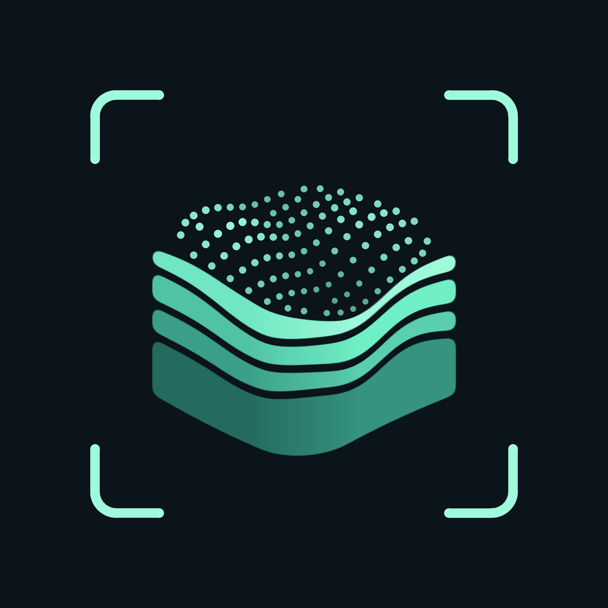
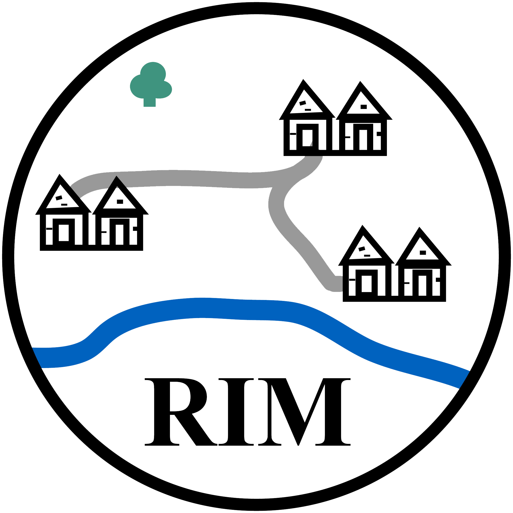

# LiDAR-Scanner für iPhone und iPad

<p align="center">
  <a href="README.md">English</a> · <strong>Deutsch</strong>
</p>

<p align="center">
  
</p>

<p align="center">
  <a href="https://github.com/Dominik-Hagmann/lidar-scanner-ios/actions/workflows/ios-build.yml"></a>
  
  
  <a href="LICENSE"></a>
</p>

<p align="center">
  <a href="https://rim.iarh.hr/index.php/en" target="_blank">
    
  </a>
  &nbsp;&nbsp;&nbsp;&nbsp;&nbsp;&nbsp;&nbsp;&nbsp;
  <a href="https://hrzz.hr/en/" target="_blank">
    
  </a>
  &nbsp;&nbsp;&nbsp;&nbsp;&nbsp;&nbsp;&nbsp;&nbsp;
  <a href="https://www.iarh.hr/en/home/" target="_blank">
    
  </a>
</p>

**LiDAR-Scanner** ist eine native, quelloffene App für LiDAR-fähige iPhones und iPads zur Erfassung einer Szene. Sie exportiert **farbige Punktwolken** oder **lokal verarbeitete Gaussian-Splatting-3D-Szenen** für die Weiterverarbeitung in Drittsoftware. Der Schwerpunkt liegt auf unkomplizierter Erfassung, transparenter Verarbeitung und offenen Exportformaten.

## Funktionen

- **Zwei Erfassungsmodi**
  - **Punktwolke** – sammelt farbige LiDAR-Tiefenpunkte; exportiert binäres PLY, ASCII-PLY und XYZ inklusive JSON-Metadaten.
  - **Gaussian Splatting** – nimmt automatisch distinkte Ansichten auf und optimiert eine 3D-Gaussian-Szene direkt auf dem Gerät.
- **Vollständig auf dem Gerät (On-Device)** – keine API-Schlüssel, externen Server oder In-App-Accounts. Scans werden offline verarbeitet; das iOS-Teilen-Menü übergibt ausschließlich die ausgewählten Dateien an das gewünschte Ziel.
- **Nachvollziehbare Protokolle** – optionaler narrativer PDF-Bericht sowie ein detailliertes Verarbeitungsprotokoll mit erfassten Einstellungen, Entscheidungen, Rechenschritten und SHA-256-Dateiprüfsummen.
- **Zuverlässige Speicherung** – automatisches Sichern beim Pausieren, kontinuierliche Arbeitsspeicherüberwachung, Checkpoints und Wiederaufnahme nach Unterbrechungen.
- **Sprachen:** Englisch (Standard) und Deutsch. iPhone im Hochformat; iPad im Hoch- und Querformat.

## Inhalte

- [Status](#status)
- [Installation](#installation)
- [Verwendung: Punktwolke](#verwendung-punktwolke)
- [Verwendung: Gaussian Splatting](#verwendung-gaussian-splatting)
- [Berichte und Verarbeitungsprotokolle](#berichte-und-verarbeitungsprotokolle)
- [Ausgabedaten](#ausgabedaten)
- [Einschränkungen](#einschränkungen)
- [Problembehebung](#problembehebung)
- [Entwicklung](#entwicklung)
- [Roadmap](#roadmap)
- [Forschungskontext: RIM-Projekt](#forschungskontext--projektzugehörigkeit-rim-projekt)
- [Zitieren](#zitieren)
- [Lizenz, Haftungsausschluss und Provenienz](#lizenz-haftungsausschluss-und-provenienz)

## Status

**Aktuelle Version:** 1.2.0 (Build 4) — siehe [Changelog](CHANGELOG.md).

| Komponente | Status |
| --- | --- |
| Punktwolken-Workflow | Auf physischem iPhone getestet (Vorgängerversion) |
| Gaussian-Workflow | Automatische Tests bestanden; **Validierung auf physischem Gerät ausstehend** |
| iPad | Unterstützt; Gerätetests noch nicht dokumentiert |

Details: [`docs/VALIDATION.md`](docs/VALIDATION.md). Version und Build sind in [`Info.plist`](LiDARScanner/Info.plist) definiert und werden in den JSON-Metadaten jedes Scans festgehalten; PLY-Header enthalten die Build-Nummer.

Die App wird als Quellcode zur Installation über Xcode bereitgestellt.

## Installation

> [!TIP]
> **Mühelose Einrichtung mit KI-Coding-Agenten:** Du kannst die Installation super einfach machen, indem du einen KI-Entwickler-Agenten wie **Google Antigravity** oder **OpenAI Codex** verwendest. Öffne einfach dieses Repository im Workspace des Agenten und frage: *„Richte dieses Projekt für mein Gerät ein und bereite es vor“* — der Agent installiert fehlende Befehlszeilen-Tools via Homebrew, führt die Setup-Skripte aus, kompiliert native Abhängigkeiten und erzeugt das Xcode-Projekt automatisch.

### Voraussetzungen

- Ein **LiDAR-fähiges iPhone oder iPad** mit **iOS bzw. iPadOS 18 oder neuer**. Die App prüft die LiDAR-Unterstützung zur Laufzeit; der Simulator und Geräte ohne LiDAR können keine Szene erfassen.
- Ein **Mac mit Xcode 16.4 oder neuer**, in einer Version, die das Betriebssystem des angeschlossenen Geräts unterstützt.
- [Homebrew](https://brew.sh) für die Build-Tools.

### Schritte

1. Repository klonen oder den Quellcode als ZIP-Archiv herunterladen und entpacken.
2. Build-Tools installieren und das Projekt vorbereiten:
   ```sh
   brew install xcodegen cmake
   bash scripts/setup.sh
   ```
   Dies lädt die fixierte Gaussian-Engine herunter und baut ihre nativen Bibliotheken. Danach `LiDARScanner.xcodeproj` in Xcode öffnen (oder `bash scripts/bootstrap.sh` ausführen, was die Einrichtung vornimmt und Xcode öffnet).
3. In **Xcode → Settings → Accounts** den eigenen Apple Account hinzufügen.
4. Unter **Target LiDARScanner → Signing & Capabilities** das eigene **Team** auswählen und **Automatically manage signing** aktiviert lassen. Falls die Bundle-ID bereits vergeben ist, `at.lidarscanner.scanner` durch eine eigene eindeutige ID ersetzen.
5. Das Gerät mit dem Mac verbinden, die Verbindung auf dem Gerät bestätigen und es in Xcode als Zielgerät auswählen. Den von Xcode angeforderten **Entwicklermodus** auf dem Gerät aktivieren.
6. **Run** bzw. **⌘R** wählen. Beim ersten Start der App den Kamerazugriff erlauben.

> [!NOTE]
> `bash scripts/setup.sh` erneut ausführen, wenn sich die fixierte Engine ändert. Build-Downloads erfolgen ausschließlich auf dem Mac; die installierte App funktioniert offline.

> [!IMPORTANT]
> Bei einem kostenlosen Apple Account (**Personal Team**) laufen Apples Berechtigungsprofile nach 7 Tagen ab; die App lässt sich dann nicht mehr öffnen und muss über Xcode neu installiert werden. **Die App nicht löschen** — siehe [Problembehebung](#problembehebung-app-ist-nicht-mehr-verfügbar).

Apple beschreibt die Geräteinstallation unter [Running your app on simulated or physical devices](https://developer.apple.com/documentation/xcode/running-your-app-on-simulated-or-physical-devices) und [Enabling Developer Mode on a device](https://developer.apple.com/documentation/xcode/enabling-developer-mode-on-a-device).

## Verwendung: Punktwolke

1. *(Optional)* Vor dem ersten Punkt über das Regler-Symbol **Rasterweite, Konfidenzschwelle, Tiefenbereich und Punktlimit** einstellen (siehe [Einstellungen](#punktwolken-einstellungen-und-speicher)).
2. Warten, bis **„Tracking stabil“** angezeigt wird.
3. **„Scan starten“** wählen und die Kamera langsam über die Szene bewegen. Die Punkte überlagern das Kamerabild; das Punktsymbol blendet sie ein oder aus.
4. **„Pausieren“** wählen. Der aktuelle Stand wird automatisch gespeichert. Solange die Kamerasitzung ohne Unterbrechung weiterläuft, kann der Scan fortgesetzt werden.
5. Über das Würfelsymbol die Punktwolke drehen und zoomen. Die Vorschau zeigt höchstens 40.000 gleichmäßig ausgewählte Punkte; der Export enthält den vollständigen Punktbestand.
6. **„Exportieren“** wählen, eine Bezeichnung vergeben, ein Format wählen und **„Sichern und teilen“** drücken.
7. Im iOS-Teilen-Menü **„In Dateien sichern“**, AirDrop oder ein anderes Ziel wählen. Punktdatei und Metadaten werden gemeinsam angeboten.

**Archiv:** Abgeschlossene Sicherungen liegen unter **Dateien → Auf meinem iPhone / Auf meinem iPad → LiDAR-Scanner → Scans**. Das Ordnersymbol öffnet das interne Archiv, wo Formate erneut geteilt und einzelne Sicherungen gelöscht werden können. Wiederholtes Sichern eines unveränderten Scans unter derselben Bezeichnung verwendet die vorhandene Sicherung; weitere Punkte oder eine andere Bezeichnung erzeugen einen neuen archivierten Stand.

### Punktwolken-Einstellungen und Speicher

| Einstellung | Standard | Optionen |
| --- | --- | --- |
| Voxel-Rasterweite | 1 cm | konfigurierbar (0,5 cm, 1 cm, 2 cm, 5 cm) |
| Konfidenzschwelle | Mittel und Hoch | konfigurierbar (Nur Hoch, Mittel und Hoch, Alle) |
| Axialer Tiefenbereich | 0,2–5 m | konfigurierbar (2 m, 3 m, 5 m) |
| Punktlimit | **Automatisch · Keine feste Punktzahl** | 500.000 · 1 Mio. · 2 Mio. · 5 Mio. · 10 Mio. |

Jeder zweite Tiefenpixel entlang jeder Bildachse wird abgetastet. Einstellungen können vor Beginn eines neuen Scans geändert werden.

Im **automatischen** Modus prüft die App vor und nach der Verarbeitung jedes Tiefenbildes den verfügbaren Arbeitsspeicher. Fällt dieser unter eine Reserve von **256 MiB**, stoppt die Erfassung und die App sichert den bisherigen Stand. Auch eine Betriebssystem-Speicherwarnung löst eine Sicherung aus. Die Speicherüberwachung bleibt auch bei einem festen Limit aktiv. Die erreichbare Punktzahl hängt vom Gerät und den aktuellen Speicherbedingungen ab; eine Sicherung vor einem abrupten Prozessabbruch kann nicht garantiert werden.

## Verwendung: Gaussian Splatting

1. **Gaussian Splatting** wählen, dann **Scan starten**.
2. Langsam um das Objekt herumgehen und es im Bild halten. Die App wählt und sichert automatisch distinkte Ansichten.
3. Auf **Fertigstellen & Erstellen** tippen. Die Berechnung startet auf dem Gerät; der Bildschirm zeigt die tatsächlich abgeschlossenen Schritte. Die App geöffnet lassen.
4. Die 3D-Szene betrachten und über **3D-Szene teilen** exportieren. **Aufnahme exportieren** liefert Bilder, Kamerakalibrierung und Posen für Drittsoftware.

**Speichern und Wiederherstellung:** Aufnahmen werden fortlaufend unter `GaussianScans` gespeichert. Rechen-Checkpoints werden alle 100 Schritte sowie bei jeder regulären Pause gesichert. Nach einer Unterbrechung den Scan über das Ordnersymbol öffnen und **Verarbeitung fortsetzen** wählen. Pausieren löscht die Aufnahme nicht. Ein abrupter Prozessabbruch kann Fortschritte seit dem letzten dauerhaften Zwischenstand verlieren; die Wiederherstellung protokolliert dies explizit.

Die Gaussian-Optimierung verwendet die ARKit-Posen direkt, ohne separate nachträgliche Posenoptimierung.

## Berichte und Verarbeitungsprotokolle

Verfügbar für Gaussian-Szenen und gespeicherte Punktwolken:

- **Details** erklärt den aktuellen Status eines Scans.
- **Bericht exportieren** erzeugt ein optionales narratives PDF.
- **Verarbeitungsprotokoll exportieren** liefert exakt protokollierte Einstellungen, Frame-Entscheidungen, Rechenschritte und Dateiprüfsummen.

Für Punktwolken dokumentieren die Berichte die Grenzen der in diesem Modus erfassten Metadaten.

## Ausgabedaten

### Punktwolken-Dateien

| Datei | Inhalt | Format |
| --- | --- | --- |
| `points.ply` | X, Y, Z, Rot, Grün, Blau, Konfidenz | Binäres Little-Endian; 16 Bytes pro Punkt plus Header |
| `points-ascii.ply` | Identische Felder | Text-PLY mit Dezimalpunkt |
| `points.xyz` | X, Y, Z | Drei leerzeichengetrennte Spalten ohne Header |
| `metadata.json` | Bezeichnung, Zeiten, Einstellungen, Punktzahl, Tiefenbildmaße, Provenienz, Koordinatentransformation | UTF-8; ISO-8601-Datumsangaben |

Jede Sicherung enthält eine binäre PLY-Datei; ASCII-PLY oder XYZ wird bei entsprechender Auswahl zusätzlich erzeugt. Farben sind 8-Bit-RGB. Die Konfidenz wird als zusätzliches `uchar`-Feld mit den ARKit-Kategorien 0, 1 und 2 gespeichert; Software, die dieses Feld ignoriert, kann Koordinaten und Farben dennoch lesen.

### Gaussian-Dateien

| Datei | Inhalt |
| --- | --- |
| `scene.ply` | Optimierte Gaussian-Szene (**3D-Szene teilen**) |
| `Capture-<id>.zip` | **Aufnahme exportieren**: `images/`, `transforms.json` (Kamerakalibrierung und Posen), `scan.json` (vollständige Parameter), `events.jsonl` (chronologische Entscheidungen, Schritte und Fehler) sowie die Ausgangspunktwolke, falls vorhanden |

SHA-256-Prüfsummen identifizieren Dateiinhalte; die verknüpften Ereignis-Hashes sind keine digitale Signatur. Durch GPU-Gleitkomma-Akkumulation und zufällige Kameraabtastung führt ein erneuter Trainingsdurchlauf nicht zwingend zu einem bitgenau identischen Ergebnis.

### Koordinatensysteme

| | Punktwolke (PLY/XYZ) | Gaussian (PLY) |
| --- | --- | --- |
| Einheit | Meter | Meter |
| Achse nach oben | **+Z** | **+Y** |
| Bezugssystem | lokal, rechtshändig | lokal |

Beide Konventionen werden in den jeweiligen Metadaten festgehalten. Für Punktwolken lautet die Transformation aus ARKit-Weltkoordinaten `(X, Y, Z) = (x, −z, y)`. Der Ursprung wird beim Start der AR-Sitzung festgelegt oder über **Neuer Scan** zurückgesetzt. Es wird kein geodätisches Bezugssystem, kein EPSG-Code und keine Nordausrichtung vergeben; die Einpassung kann nachträglich über Passpunkte erfolgen.

### Datenprovenienz

Der Punktwolkenmodus verwendet `ARFrame.sceneDepth`, die zugehörige Konfidenzkarte, Kamerakalibrierung und Kamerapose; Farben stammen aus demselben `ARFrame.capturedImage`. Tiefenpunkte werden über Frames hinweg akkumuliert – es handelt sich weder um Dreiecksnetz-Vertices noch um AR-Tracking-Featurepunkte.

> [!IMPORTANT]
> `sceneDepth` ist eine von Apple aus LiDAR- und Kameradaten berechnete Tiefenkarte, **keine unverarbeiteten Einzel-Lasermessungen** (siehe Apples [Depth API Präsentation](https://developer.apple.com/videos/play/wwdc2020/10611/)). Die App wendet keine zusätzliche zeitliche Glättung via `smoothedSceneDepth` an.
>
> Die 1-cm-Voxelrasterweite beschreibt eine räumliche Unterabtastung und ist **keine Zusicherung einer 1-cm-Messgenauigkeit**.

Pro Rasterzelle wird zunächst eine Beobachtung gespeichert; eine spätere Beobachtung ersetzt diese nur bei höherer Konfidenz. Es findet keine Mittelwertbildung, Oberflächenrekonstruktion oder globale Ausgleichung statt. Details: [`docs/TECHNICAL_DESCRIPTION.md`](docs/TECHNICAL_DESCRIPTION.md).

## Einschränkungen

**Allgemein**

- Die Erfassung erfordert LiDAR-Hardware und iOS/iPadOS 18 oder neuer. Tests auf dem iPad sind noch nicht dokumentiert.
- Die App erhebt keinen Anspruch auf vermessungstechnische Genauigkeit oder vollständige Abdeckung. Ergebnisse sollten anhand von Kontrollgeometrien auf dem realen Gerät validiert werden.
- Kein Import aus anderen Scan-Apps; kein LAS-, LAZ- oder E57-Export. Die offenen Punktformate bieten eine Grundlage zur Konvertierung.

**Punktwolke**

- Bei eingeschränktem Tracking werden keine Punkte hinzugefügt. Relokalisierung, Kameraunterbrechung, Wechsel in den Hintergrund und Speicherwarnungen schließen die aktuelle Erfassung ab; die akkumulierte Punktwolke bleibt exportierbar, und weitere Aufnahmen beginnen als neuer Scan.
- Gespeicherte Punkte werden nach späteren ARKit-Posekorrekturen nicht neu optimiert; längere Erfassungen können driften.
- Das Speichern erfolgt automatisch beim Pausieren sowie nach bestem Vermögen beim Wechsel in den Hintergrund. Punkte seit der letzten vollständigen Sicherung können bei Prozessbeendigung verloren gehen.
- Ein Neustart der App setzt die vorherige AR-Sitzung nicht fort; archivierte Scans können erneut geteilt, aber nicht weitergeführt werden.

**Gaussian Splatting**

- Bislang nicht auf einem physischen Gerät validiert. Visuelle Qualität, Geschwindigkeit, Speichernutzung und Wärmeentwicklung erfordern Tests auf dem Zielgerät.
- ARKit-Posen werden ohne separate nachträgliche Posenoptimierung verwendet.

## Problembehebung

### Problembehebung: App ist nicht mehr verfügbar

Wenn iOS oder iPadOS beim Antippen des Icons einer über Xcode installierten App meldet: **„App ist nicht mehr verfügbar“** (englisch: *„App is no longer available“*):

> [!CAUTION]
> **Die App nicht löschen** — [beim Löschen einer App werden auch ihre lokalen Daten entfernt](https://support.apple.com/de-de/guide/iphone/remove-or-delete-apps-iph248b543ca/ios). Falls zugänglich, zuerst den Ordner **Dateien → Auf meinem iPhone / Auf meinem iPad → LiDAR-Scanner → Scans** in iCloud Drive oder auf einen Mac kopieren.

1. Das Gerät mit dem Mac verbinden und entsperren.
2. Dasselbe `LiDARScanner.xcodeproj` öffnen, das für die Erstinstallation verwendet wurde, und das physische Gerät (nicht den Simulator) als Ziel auswählen.
3. Unter **Target LiDARScanner → Signing & Capabilities** dasselbe **Team** und dieselbe **Bundle-ID** beibehalten.
4. **Run** bzw. **⌘R** wählen, um die App neu zu bauen, zu signieren und einzuspielen, ohne sie vorher zu löschen.
5. Das Scan-Archiv prüfen und bestätigen, dass sich die App wieder über das Home-Bildschirm-Symbol öffnet.

**Warum das hilft:** Die Signierung oder das Berechtigungsprofil der App ist möglicherweise abgelaufen. Bei einem kostenlosen Apple Account (**Personal Team**) laufen Berechtigungsprofile **nach 7 Tagen ab** ([Entwickler-Account Übersicht → Personal Team in Xcode](https://developer.apple.com/help/account/basics/about-your-developer-account)). Dies ist eine Einschränkung von Apple, keine von LiDAR-Scanner implementierte Frist.

**Falls sie sich weiterhin nicht öffnet:** Den genauen Signierungs- oder Installationsfehler in Xcode prüfen; die iOS-Meldung allein bestätigt noch kein abgelaufenes Profil. Eine Neuinstallation ersetzt keine separate Sicherung exportierter Scans.

## Entwicklung

### Kompilieren und Testen

Zuerst das Projekt vorbereiten (`brew install xcodegen cmake && bash scripts/setup.sh`). Danach:

```sh
# C++ Kern- und Exporttests (C++17 Compiler und Python 3)
bash Tests/run.sh

# Unsignierter Simulator-Build
xcodebuild -project LiDARScanner.xcodeproj -scheme LiDARScanner \
  -configuration Debug -destination 'generic/platform=iOS Simulator' \
  CODE_SIGNING_ALLOWED=NO build

# Unit- und UI-Tests im Simulator (Screenshots in build/screenshots)
bash scripts/test-ios.sh
```

Ein Simulator-Build prüft die iOS-Integration; die LiDAR-Erfassung kann ausschließlich auf einem realen Gerät getestet werden. Der [GitHub-Actions-Workflow](.github/workflows/ios-build.yml) baut die fixierte Gaussian-Engine, erzeugt das Projekt aus [`project.yml`](project.yml) und führt Simulator- und Release-Builds sowie Tests aus. `project.yml` und das eingecheckte Xcode-Projekt synchron halten.

### Architektur

| Pfad | Aufgabe |
| --- | --- |
| `LiDARScanner/ScanModel.swift` | Punktwolken-Sitzung, Berechtigungen, Unterbrechungen, Speicherung |
| `LiDARScanner/DepthProcessor.swift` | Übergibt gepufferte Tiefen- und Farbdaten an den C++ Kern |
| `LiDARScanner/Core/PointCloudCore.cpp` | Rückprojektion, Voxel-Auswahl, Dateiexport (über C-Schnittstelle mit Swift verknüpft) |
| `LiDARScanner/Gaussian/` | Gaussian-Erfassung, Speicherung, Verarbeitung und native Engine-Bridge |
| `LiDARScanner/Reports/` | PDF-Berichte und Verarbeitungsprotokolle |
| `LiDARScanner/Views/` | Native Benutzeroberfläche, Kamera-, Punktwolken- und Gaussian-Vorschau |
| `scripts/` | Setup-, Engine-Vorbereitungs- und Testskripte |

Der Gaussian-Modus nutzt msplat-ios und MetalSplatter; siehe [Third-Party-Hinweise](THIRD_PARTY_NOTICES.md). Geometrie- und Validierungsdetails: [`docs/TECHNICAL_DESCRIPTION.md`](docs/TECHNICAL_DESCRIPTION.md), [`docs/VALIDATION.md`](docs/VALIDATION.md). Beiträge sind willkommen — siehe [`CONTRIBUTING.md`](CONTRIBUTING.md).

## Roadmap

Zukünftige Erweiterungen, keine Funktionen der Version 1.2.0 (Build 4):

1. CSV-Export als zusätzliches offenes Textformat.
2. GNSS-Metadaten zur Georeferenzierung von Scans.

## Forschungskontext & Projektzugehörigkeit (RIM-Projekt)

Diese Anwendung wird im Rahmen des Forschungsprojekts **[Tracing the Empire’s Territorial Remnants and Infrastructural Systems in Pannonia: Roman Infrastructure Mapping (RIM)](https://rim.iarh.hr/index.php/en)** (Projekt-ID: `IP-2025-02-1060`, 2025–2028) entwickelt und eingesetzt.

<p align="center">
  <a href="https://rim.iarh.hr/index.php/en" target="_blank">
    
  </a>
  &nbsp;&nbsp;&nbsp;&nbsp;&nbsp;&nbsp;&nbsp;&nbsp;&nbsp;&nbsp;
  <a href="https://hrzz.hr/en/" target="_blank">
    
  </a>
  &nbsp;&nbsp;&nbsp;&nbsp;&nbsp;&nbsp;&nbsp;&nbsp;&nbsp;&nbsp;
  <a href="https://www.iarh.hr/en/home/" target="_blank">
    
  </a>
</p>

- **Projekttitel:** *Tracing the Empire’s Territorial Remnants and Infrastructural Systems in Pannonia: Roman Infrastructure Mapping – RIM* ([rim.iarh.hr](https://rim.iarh.hr/index.php/en))
- **Projektcode:** IP-2025-02-1060 (Dezember 2025 – Dezember 2028)
- **Gasteinrichtung:** [Institut za arheologiju / Archäologisches Institut (IARH)](https://www.iarh.hr/en/home/), Zagreb, Kroatien
- **Fördergeber:** [Hrvatska zaklada za znanost / Kroatische Wissenschaftsstiftung (HRZZ)](https://hrzz.hr/en/)
- **Forschungsschwerpunkt:** Eine interdisziplinäre Initiative zur Erforschung und Rekonstruktion provinzialrömischer ländlicher Landschaften und infrastruktureller Netzwerke im östlichen Kroatien (antikes Pannonien) durch Fernerkundung, GIS-Integration und LiDAR-gestützte 3D-Felderfassung.

## Zitieren

Für wissenschaftliche, didaktische oder dokumentarische Nutzung sollte die konkret verwendete Softwareversion und Build-Nummer zitiert werden. GitHub liest [`CITATION.cff`](CITATION.cff) und bietet die Option „Cite this repository“.

> Hagmann, D. (2026). *LiDAR Scanner for iPhone and iPad* (Version 1.2.0, Build 4) [Computer software]. GitHub. https://github.com/Dominik-Hagmann/lidar-scanner-ios

<details>
<summary><strong>Ausgewählte Literatur zu LiDAR auf iPhone und iPad</strong></summary>

- Antón, D., Mayoral-Valsera, J., Simón-Vallejo, M. D., Parrilla-Giráldez, R., & Cortés-Sánchez, M. (2025). Built-in smartphone LiDAR for archaeological and speleological research. *Journal of Archaeological Science, 181*, 106330. [https://doi.org/10.1016/j.jas.2025.106330](https://doi.org/10.1016/j.jas.2025.106330)
- Bhatta, B. P., Shah, A., Chaulagain, M. K., Dhungana, A., Mandal, L., Koirala, P., Thapa, S., & Panday, U. S. (2025). Comparative Assessment of Archaeological Scene Reconstruction Using iPhone LiDAR Scanner. *Journal on Geoinformatics, Nepal, 24*, 9–19. [https://doi.org/10.3126/njg.v24i1.79342](https://doi.org/10.3126/njg.v24i1.79342)
- Costantino, D., Vozza, G., Pepe, M., & Alfio, V. S. (2022). Smartphone LiDAR Technologies for Surveying and Reality Modelling in Urban Scenarios: Evaluation Methods, Performance and Challenges. *Applied System Innovation, 5*(4), 63. [https://doi.org/10.3390/asi5040063](https://doi.org/10.3390/asi5040063)
- Dora, D., Lazaridis, G., Tokmakidis, P., Trimmis, K. P., Veni, G., Tokmakidis, K., & Vouvalidis, K. (2026). Low-cost smartphone LiDAR for 3D cave mapping: comparing mobile and terrestrial laser scanning methods. *Geology Today, 42*, 147–153. [https://doi.org/10.1111/gto.70022](https://doi.org/10.1111/gto.70022)
- Furlan, L. M., & Piazentim, E. G. (2025). Smartphone-based LiDAR for generating Digital Outcrop Models (DOMs) with field validation. *Discover Geoscience, 3*, 137. [https://doi.org/10.1007/s44288-025-00253-z](https://doi.org/10.1007/s44288-025-00253-z)
- Gollob, C., Ritter, T., Kraßnitzer, R., Tockner, A., & Nothdurft, A. (2021). Measurement of Forest Inventory Parameters with Apple iPad Pro and Integrated LiDAR Technology. *Remote Sensing, 13*(16), 3129. [https://doi.org/10.3390/rs13163129](https://doi.org/10.3390/rs13163129)
- Luetzenburg, G., Kroon, A., & Bjørk, A. A. (2021). Evaluation of the Apple iPhone 12 Pro LiDAR for an Application in Geosciences. *Scientific Reports, 11*, 22221. [https://doi.org/10.1038/s41598-021-01763-9](https://doi.org/10.1038/s41598-021-01763-9)
- Luetzenburg, G., Kroon, A., Kjeldsen, K. K., Splinter, K. D., & Bjørk, A. A. (2024). High-resolution topographic surveying and change detection with the iPhone LiDAR. *Nature Protocols, 19*, 3520–3541. [https://doi.org/10.1038/s41596-024-01024-9](https://doi.org/10.1038/s41596-024-01024-9)
- Paukkonen, N. (2023). Towards a Mobile 3D Documentation Solution. Video-Based Photogrammetry and iPhone 12 Pro as Fieldwork Documentation Tools. *Journal of Computer Applications in Archaeology, 6*(1), 143–154. [https://doi.org/10.5334/jcaa.135](https://doi.org/10.5334/jcaa.135)
- Soyluoğlu, M., Orabi, R., Hermon, S., & Bakirtzis, N. (2025). Digitizing Challenging Heritage Sites with the Use of iPhone LiDAR and Photogrammetry: The Case-Study of Sourp Magar Monastery in Cyprus. *Geomatics, 5*(3), 44. [https://doi.org/10.3390/geomatics5030044](https://doi.org/10.3390/geomatics5030044)

</details>

## Lizenz, Haftungsausschluss und Provenienz

Der Quellcode steht unter der [MIT-Lizenz](LICENSE). Hinweise zur KI-unterstützten Entwicklung enthält [`AI_DISCLOSURE.md`](AI_DISCLOSURE.md).

**LiDAR-Scanner wird „WIE BESEHEN“ („AS IS“) zur Verfügung gestellt, ohne jegliche ausdrückliche oder stillschweigende Gewährleistung**, wie in der [MIT-Lizenz](LICENSE) dargelegt.

Die Software ist für Forschung, archäologische Dokumentation und verwandte Feldanwendungen konzipiert. Es wird keine Gewähr für die Richtigkeit oder Vollständigkeit der Ergebnisse, die Eignung für Vermessungsaufgaben, die Datenintegrität oder den unterbrechungsfreien Betrieb übernommen. Nutzerinnen und Nutzer sollten Ergebnisse eigenverantwortlich anhand geeigneter Referenzmessungen überprüfen und Sicherungskopien ihrer Scandaten anlegen.

Soweit gesetzlich zulässig, haften die Urheber, Rechteinhaber und Mitwirkenden nicht für direkte, indirekte, zufällige oder Folgeschäden (einschließlich Datenverlust oder Arbeitsunterbrechungen), die aus der Nutzung oder Unfähigkeit zur Nutzung der Software entstehen. Die Nutzung von LiDAR-Scanner erfolgt auf eigene Gefahr und Verantwortung.

Dieser Abschnitt bietet zusätzliche Anwendungshinweise und ersetzt oder ändert die Bestimmungen der [MIT-Lizenz](LICENSE) nicht.
