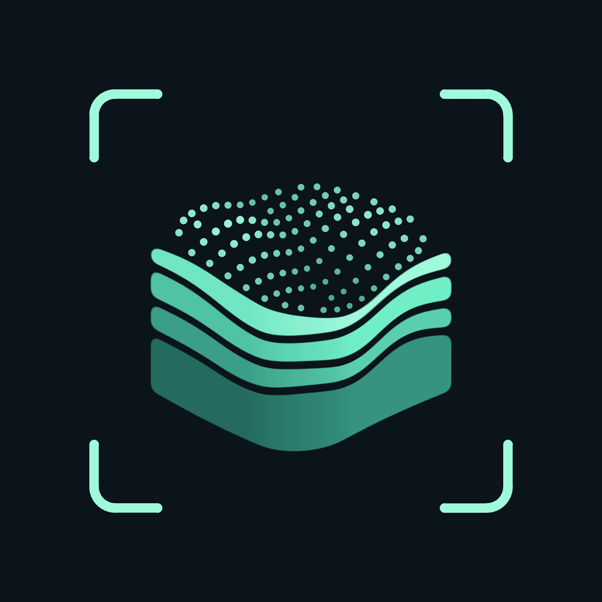
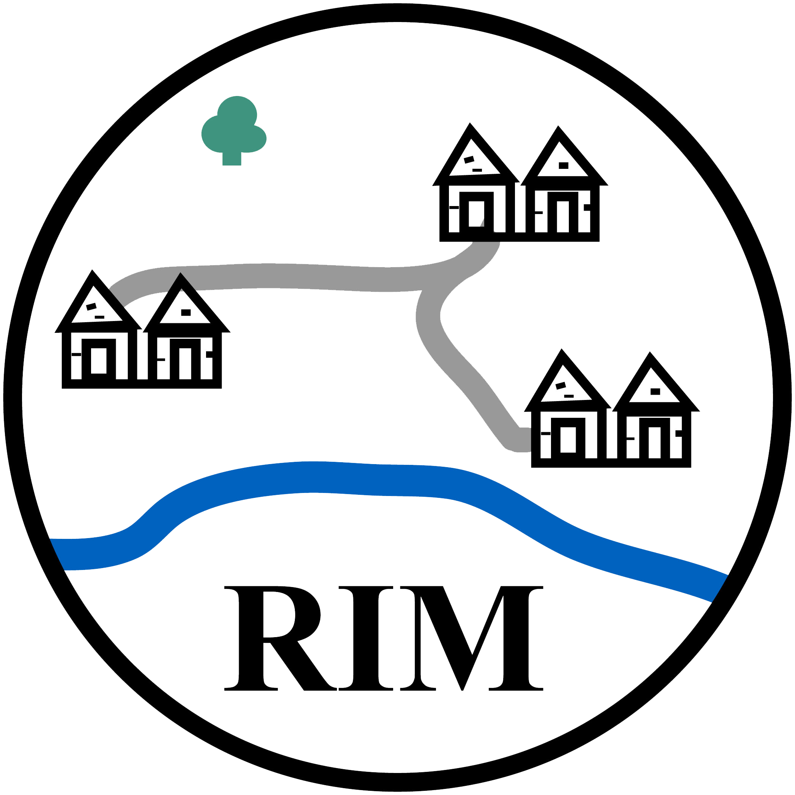

# LiDAR Scanner for iPhone and iPad

<p align="center">
  
</p>

<p align="center">
  <a href="https://github.com/Dominik-Hagmann/lidar-scanner-ios/actions/workflows/ios-build.yml"></a>
  
  
  <a href="LICENSE"></a>
</p>

<p align="center">
  <a href="https://rim.iarh.hr/index.php/en" target="_blank">
    
  </a>
  &nbsp;&nbsp;&nbsp;&nbsp;&nbsp;&nbsp;&nbsp;&nbsp;
  <a href="https://hrzz.hr/en/" target="_blank">
    
  </a>
  &nbsp;&nbsp;&nbsp;&nbsp;&nbsp;&nbsp;&nbsp;&nbsp;
  <a href="https://www.iarh.hr/en/home/" target="_blank">
    
  </a>
</p>

**LiDAR Scanner** is a native, open-source app for capturing scenes with LiDAR-equipped iPhones and iPads. It exports **coloured point clouds** or **locally processed Gaussian scenes** for further work in other software. The app focuses on straightforward capture, transparent processing and open export formats.

## Features

- **Two capture modes**
  - **Point Cloud** – accumulates coloured LiDAR depth points; exports binary PLY, ASCII PLY and XYZ with JSON metadata.
  - **Gaussian Splatting** – captures distinct views automatically and optimizes a 3D Gaussian scene directly on the device.
- **Fully on-device** – no API keys, servers or in-app accounts. Scans are processed offline; the share sheet passes only the selected files to the destination chosen by the user.
- **Traceable records** – optional narrative PDF report and a processing log with recorded settings, decisions, processing steps and SHA-256 file hashes.
- **Robust saving** – automatic saves on pause, memory monitoring, processing checkpoints and recovery after interruption.
- **Languages:** English (default) and German. iPhone in portrait; iPad in portrait and landscape.

## Contents

- [Status](#status)
- [Installation](#installation)
- [Usage: Point Cloud](#usage-point-cloud)
- [Usage: Gaussian Splatting](#usage-gaussian-splatting)
- [Reports and Processing Logs](#reports-and-processing-logs)
- [Output Data](#output-data)
- [Limitations](#limitations)
- [Troubleshooting](#troubleshooting)
- [Development](#development)
- [Roadmap](#roadmap)
- [Research Context: RIM Project](#research-context--project-affiliation-rim-project)
- [Citation](#citation)
- [License, Disclaimer and Provenance](#license-disclaimer-and-provenance)

## Status

**Current version:** 1.2.0 (Build 4) — see the [changelog](CHANGELOG.md).

| Component | Status |
| --- | --- |
| Point-cloud workflow | Tested on a physical iPhone (previous version) |
| Gaussian workflow | Automated tests pass; **physical-device validation pending** |
| iPad | Supported; device testing not yet documented |

Details: [`docs/VALIDATION.md`](docs/VALIDATION.md). Version and build are defined in [`Info.plist`](LiDARScanner/Info.plist) and recorded in each scan's JSON metadata; PLY headers include the build number.

The app is distributed as source code for installation through Xcode.

## Installation

> [!TIP]
> **Effortless setup with AI coding agents:** You can make the installation super simple by using an AI developer agent such as **Google Antigravity** or **OpenAI Codex**. Just open this repository in the agent workspace and ask: *"Set up and prepare this project for my device"* — the agent will install missing command-line tools via Homebrew, run the setup scripts, compile native dependencies, and generate the Xcode project automatically.

### Requirements

- A **LiDAR-equipped iPhone or iPad** running **iOS or iPadOS 18 or later**. The app checks LiDAR support at runtime; the Simulator and devices without LiDAR cannot capture.
- A **Mac with Xcode 16.4 or later**, in a version that supports the OS installed on the connected device.
- [Homebrew](https://brew.sh) for the build tools.

### Steps

1. Clone the repository, or download and extract the source code as a ZIP archive.
2. Install the build tools and prepare the project:
   ```sh
   brew install xcodegen cmake
   bash scripts/setup.sh
   ```
   This downloads the pinned Gaussian engine and builds its native libraries. Then open `LiDARScanner.xcodeproj` in Xcode (or run `bash scripts/bootstrap.sh`, which performs setup and opens Xcode).
3. Add your Apple Account under **Xcode → Settings → Accounts**.
4. Under **Target LiDARScanner → Signing & Capabilities**, select your own **Team** and leave **Automatically manage signing** enabled. If the bundle identifier is already in use, replace `at.lidarscanner.scanner` with your own unique identifier.
5. Connect the device, confirm the connection on it, and select it as the destination in Xcode. Enable **Developer Mode** on the device if requested.
6. Select **Run** or press **⌘R**. Grant camera access when the app launches for the first time.

> [!NOTE]
> Run `bash scripts/setup.sh` again whenever the pinned engine changes. Build-time downloads happen on the Mac only; the installed app works offline.

> [!IMPORTANT]
> With a free Apple Account (**Personal Team**), Apple's provisioning profiles expire after 7 days; the app then stops opening and must be reinstalled from Xcode. **Do not delete the app** — see [Troubleshooting](#troubleshooting-app-no-longer-available).

Apple documents device installation in [Running your app on simulated or physical devices](https://developer.apple.com/documentation/xcode/running-your-app-on-simulated-or-physical-devices) and [Enabling Developer Mode on a device](https://developer.apple.com/documentation/xcode/enabling-developer-mode-on-a-device).

## Usage: Point Cloud

1. *(Optional)* Before capturing the first point, tap the sliders icon to configure **voxel-grid spacing, confidence threshold, depth range and point limit** (see [Settings](#point-cloud-settings-and-memory)).
2. Wait until **Tracking stable** is displayed.
3. Tap **Start Scan** and move the camera slowly across the scene. Points are superimposed on the camera image; the point icon shows or hides them.
4. Tap **Pause**. The current state is saved automatically. The scan can be resumed as long as the camera session continues without interruption.
5. Use the cube icon to rotate and zoom the point cloud. The preview shows at most 40,000 evenly selected points; the export contains the complete point set.
6. Tap **Export**, enter a designation, choose a format, and tap **Save and Share**.
7. In the share sheet, choose **Save to Files**, AirDrop or another destination. The point file and metadata are offered together.

**Archive:** Completed saves are stored under **Files → On My iPhone / On My iPad → LiDAR-Scanner → Scans**. The folder icon opens the internal archive, where formats can be shared again and individual saves deleted. Saving an unchanged scan under the same designation reuses the existing save; additional points or a different designation create a new archived state.

### Point-cloud settings and memory

| Setting | Default | Options |
| --- | --- | --- |
| Voxel-grid spacing | 1 cm | configurable |
| Confidence threshold | medium or high | configurable |
| Axial depth range | 0.2–5 m | configurable |
| Point limit | **Automatic · No Fixed Point Count** | 500,000 · 1 M · 2 M · 5 M · 10 M |

Every second depth pixel along each image axis is sampled. Settings can be changed before starting a new scan.

In **automatic** mode, the app checks the memory available to its process before and after processing each depth image. If it falls below a reserve of **256 MiB**, capture stops and the app attempts to save the scan acquired so far. An operating-system memory warning also triggers a save attempt. Memory monitoring remains active with a fixed limit. The attainable point count depends on the device and its current memory conditions; a save before an abrupt process termination cannot be guaranteed.

## Usage: Gaussian Splatting

1. Select **Gaussian Splatting**, then **Start Scan**.
2. Move slowly around the subject, keeping it in view. The app selects and saves distinct views automatically.
3. Tap **Finish and Create**. Processing starts on the device, and the screen shows the steps actually completed. Keep the app open.
4. View the scene, then use **Share 3D Scene**. **Export Capture** provides the images, camera calibration and poses for other software.

**Saving and recovery:** Captures are saved progressively under `GaussianScans`. Processing checkpoints are saved every 100 steps and whenever a pause can be handled. After an interruption, reopen the scan from the folder icon and choose **Continue Processing**. Pausing does not delete the capture. A sudden termination can lose work since the last durable save; recovery records this explicitly.

Gaussian optimization uses ARKit poses directly, without separate pose refinement.

## Reports and Processing Logs

Available for Gaussian scenes and saved point clouds:

- **Details** explains the current state of a scan.
- **Export Report** creates an optional narrative PDF.
- **Export Processing Log** provides the exact recorded settings, frame decisions, processing steps and file hashes.

For point clouds, reports state the limits of the metadata recorded by that mode.

## Output Data

### Point-cloud files

| File | Content | Encoding |
| --- | --- | --- |
| `points.ply` | X, Y, Z, red, green, blue, confidence | Binary little-endian; 16 bytes per point plus header |
| `points-ascii.ply` | Identical fields | Text PLY with a decimal point |
| `points.xyz` | X, Y, Z | Three space-separated columns without a header |
| `metadata.json` | Designation, times, settings, point count, depth-image dimensions, provenance, coordinate transformation | UTF-8; ISO 8601 dates |

Every save contains a binary PLY file; ASCII PLY or XYZ is generated additionally when selected. Colours are 8-bit RGB. Confidence is stored as an additional `uchar` field using the ARKit categories 0, 1 and 2; software that ignores this field can still read coordinates and colours.

### Gaussian files

| File | Content |
| --- | --- |
| `scene.ply` | Optimized Gaussian scene (**Share 3D Scene**) |
| `Capture-<id>.zip` | **Export Capture**: `images/`, `transforms.json` (camera calibration and poses), `scan.json` (full parameters), `events.jsonl` (chronological decisions, steps and errors) and the depth seed, if present |

SHA-256 checksums identify file contents; the linked event hashes are not a digital signature. GPU floating-point accumulation and random camera sampling mean that rerunning training need not produce a bit-identical result.

### Coordinate systems

| | Point cloud (PLY/XYZ) | Gaussian (PLY) |
| --- | --- | --- |
| Unit | metres | metres |
| Up axis | **+Z** | **+Y** |
| Frame | local, right-handed | local |

Both conventions are recorded in the respective metadata. For point clouds, the transformation from ARKit world coordinates is `(X, Y, Z) = (x, −z, y)`. The origin is set when the AR session starts or is reset with **New Scan**. No geographic reference, EPSG identifier or north orientation is assigned; data can be registered afterwards using external control points.

### Data provenance

The point-cloud mode uses `ARFrame.sceneDepth`, its confidence map, camera calibration and camera pose; colours come from the same `ARFrame.capturedImage`. Depth points are accumulated across frames — they are neither mesh vertices nor AR tracking feature points.

> [!IMPORTANT]
> `sceneDepth` is an Apple-processed depth map derived from LiDAR and camera data, **not unprocessed individual laser measurements** (see Apple's [Depth API presentation](https://developer.apple.com/videos/play/wwdc2020/10611/)). The app does not apply the additional temporal smoothing of `smoothedSceneDepth`.
>
> The 1 cm voxel-grid spacing describes spatial subsampling and is **not a claim of 1 cm accuracy**.

One observation is initially retained per grid cell; a later observation replaces it only if it has higher confidence. No averaging, surface reconstruction or global registration is performed. More detail: [`docs/TECHNICAL_DESCRIPTION.md`](docs/TECHNICAL_DESCRIPTION.md).

## Limitations

**General**

- Capture requires LiDAR hardware and iOS/iPadOS 18 or later. iPad device testing is not yet documented.
- The app does not assert survey accuracy or complete coverage. Validate results against control geometry on the actual device.
- No import from other scanning apps; no LAS, LAZ or E57 export. The open point formats provide a basis for conversion.

**Point Cloud**

- No points are added while tracking is limited. Relocalisation, camera interruption, moving to the background and memory warnings close the current capture; the accumulated point cloud remains exportable, and subsequent capture begins as a new scan.
- Accumulated points are not re-optimised after later ARKit pose corrections; long acquisitions may drift.
- Saving happens automatically on pause and as a best-effort save when moving to the background. Points captured since the last completed save may be lost if the app is terminated. Continuous long-term logging is not guaranteed.
- Restarting the app does not resume the previous AR session; archived scans can be shared again but not continued.

**Gaussian Splatting**

- Not yet validated on a physical device. Appearance, speed, memory use and heat require validation on the target iPhone.
- ARKit poses are used without separate pose refinement.

## Troubleshooting

### Troubleshooting: app no longer available

If iOS or iPadOS shows **“App is no longer available”** (German: **„App ist nicht mehr verfügbar“**; wording may vary) when you tap the icon of an app installed through Xcode:

> [!CAUTION]
> **Do not delete the app** — [deleting an app also removes its local data](https://support.apple.com/guide/iphone/remove-or-delete-apps-iph248b543ca/ios). If accessible, first copy **Files → On My iPhone / On My iPad → LiDAR-Scanner → Scans** to iCloud Drive or a Mac.

1. Connect the device to the Mac and unlock it.
2. Open the same `LiDARScanner.xcodeproj` used for the original installation and select the physical device (not the Simulator).
3. Under **Target LiDARScanner → Signing & Capabilities**, keep the **same Team and Bundle Identifier** used for the original installation.
4. Select **Run** or press **⌘R** to rebuild, sign and deploy the app again without deleting it first.
5. Check the scan archive and confirm that the app opens from its Home Screen icon again.

**Why this helps:** The app's signing or provisioning may no longer be valid. With a free Apple Account (**Personal Team**), an expired provisioning profile is the likely cause, especially if the app stopped opening after several days. Apple states that these profiles expire **7 days after issuance** ([Developer account overview → Enable a personal team in Xcode](https://developer.apple.com/help/account/basics/about-your-developer-account)). This is an Apple restriction, not a time limit implemented by LiDAR Scanner.

**If it still does not open:** Check the exact signing or installation error in Xcode before making further changes; the iOS message alone does not confirm an expired profile. Reinstalling is not a substitute for a separate backup of exported scans.

## Development

### Build and test

Prepare the project first (`brew install xcodegen cmake && bash scripts/setup.sh`). Then:

```sh
# C++ core and export tests (C++17 compiler and Python 3)
bash Tests/run.sh

# Unsigned Simulator build
xcodebuild -project LiDARScanner.xcodeproj -scheme LiDARScanner \
  -configuration Debug -destination 'generic/platform=iOS Simulator' \
  CODE_SIGNING_ALLOWED=NO build

# Unit and UI tests in the Simulator (screenshots in build/screenshots)
bash scripts/test-ios.sh
```

A Simulator build tests the iOS integration; LiDAR capture can be tested only on a physical device. The [GitHub Actions workflow](.github/workflows/ios-build.yml) builds the pinned Gaussian engine, generates the project from [`project.yml`](project.yml), and runs the Simulator and unsigned Release builds and the tests. Keep `project.yml` and the checked-in Xcode project synchronized.

### Architecture

| Path | Responsibility |
| --- | --- |
| `LiDARScanner/ScanModel.swift` | Point-cloud session, permissions, interruptions, saving |
| `LiDARScanner/DepthProcessor.swift` | Passes buffered depth and colour data to the C++ core |
| `LiDARScanner/Core/PointCloudCore.cpp` | Back-projection, voxel selection, file export (bridged to Swift via C interface) |
| `LiDARScanner/Gaussian/` | Gaussian capture, storage, processing and native engine bridge |
| `LiDARScanner/Reports/` | PDF reports and processing records |
| `LiDARScanner/Views/` | Native interface, camera, point-cloud and Gaussian previews |
| `scripts/` | Setup, engine preparation and test scripts |

The Gaussian mode uses msplat-ios and MetalSplatter; see [third-party notices](THIRD_PARTY_NOTICES.md). Geometry and validation details: [`docs/TECHNICAL_DESCRIPTION.md`](docs/TECHNICAL_DESCRIPTION.md), [`docs/VALIDATION.md`](docs/VALIDATION.md). Contributions are welcome — see [`CONTRIBUTING.md`](CONTRIBUTING.md).

## Roadmap

Prospective additions, not features of version 1.2.0 (Build 4):

1. CSV export as an additional open text format.
2. GNSS metadata accompanying scans.

## Research Context & Project Affiliation (RIM Project)

This application is developed and used within the research project **[Tracing the Empire’s Territorial Remnants and Infrastructural Systems in Pannonia: Roman Infrastructure Mapping (RIM)](https://rim.iarh.hr/index.php/en)** (Project ID: `IP-2025-02-1060`, 2025–2028).

<p align="center">
  <a href="https://rim.iarh.hr/index.php/en" target="_blank">
    
  </a>
  &nbsp;&nbsp;&nbsp;&nbsp;&nbsp;&nbsp;&nbsp;&nbsp;&nbsp;&nbsp;
  <a href="https://hrzz.hr/en/" target="_blank">
    
  </a>
  &nbsp;&nbsp;&nbsp;&nbsp;&nbsp;&nbsp;&nbsp;&nbsp;&nbsp;&nbsp;
  <a href="https://www.iarh.hr/en/home/" target="_blank">
    
  </a>
</p>

- **Project Title:** *Tracing the Empire’s Territorial Remnants and Infrastructural Systems in Pannonia: Roman Infrastructure Mapping – RIM* ([rim.iarh.hr](https://rim.iarh.hr/index.php/en))
- **Project Code:** IP-2025-02-1060 (December 2025 – December 2028)
- **Host Institution:** [Institut za arheologiju / Institute of Archaeology (IARH)](https://www.iarh.hr/en/home/), Zagreb, Croatia
- **Funding Body:** [Hrvatska zaklada za znanost / Croatian Science Foundation (HRZZ)](https://hrzz.hr/en/)
- **Research Scope:** An interdisciplinary initiative exploring and reconstructing provincial Roman rural landscapes and infrastructural networks in eastern Croatia (ancient Pannonia) through remote sensing, GIS integration, and LiDAR-based 3D field recording.

## Citation

Scientific, educational or documentary use should cite the specific version and build used. GitHub reads [`CITATION.cff`](CITATION.cff) and offers a “Cite this repository” option.

> Hagmann, D. (2026). *LiDAR Scanner for iPhone and iPad* (Version 1.2.0, Build 4) [Computer software]. GitHub. https://github.com/Dominik-Hagmann/lidar-scanner-ios

<details>
<summary><strong>Selected literature on LiDAR for iPhone and iPad</strong></summary>

- Antón, D., Mayoral-Valsera, J., Simón-Vallejo, M. D., Parrilla-Giráldez, R., & Cortés-Sánchez, M. (2025). Built-in smartphone LiDAR for archaeological and speleological research. *Journal of Archaeological Science, 181*, 106330. [https://doi.org/10.1016/j.jas.2025.106330](https://doi.org/10.1016/j.jas.2025.106330)
- Bhatta, B. P., Shah, A., Chaulagain, M. K., Dhungana, A., Mandal, L., Koirala, P., Thapa, S., & Panday, U. S. (2025). Comparative Assessment of Archaeological Scene Reconstruction Using iPhone LiDAR Scanner. *Journal on Geoinformatics, Nepal, 24*, 9–19. [https://doi.org/10.3126/njg.v24i1.79342](https://doi.org/10.3126/njg.v24i1.79342)
- Costantino, D., Vozza, G., Pepe, M., & Alfio, V. S. (2022). Smartphone LiDAR Technologies for Surveying and Reality Modelling in Urban Scenarios: Evaluation Methods, Performance and Challenges. *Applied System Innovation, 5*(4), 63. [https://doi.org/10.3390/asi5040063](https://doi.org/10.3390/asi5040063)
- Dora, D., Lazaridis, G., Tokmakidis, P., Trimmis, K. P., Veni, G., Tokmakidis, K., & Vouvalidis, K. (2026). Low-cost smartphone LiDAR for 3D cave mapping: comparing mobile and terrestrial laser scanning methods. *Geology Today, 42*, 147–153. [https://doi.org/10.1111/gto.70022](https://doi.org/10.1111/gto.70022)
- Furlan, L. M., & Piazentim, E. G. (2025). Smartphone-based LiDAR for generating Digital Outcrop Models (DOMs) with field validation. *Discover Geoscience, 3*, 137. [https://doi.org/10.1007/s44288-025-00253-z](https://doi.org/10.1007/s44288-025-00253-z)
- Gollob, C., Ritter, T., Kraßnitzer, R., Tockner, A., & Nothdurft, A. (2021). Measurement of Forest Inventory Parameters with Apple iPad Pro and Integrated LiDAR Technology. *Remote Sensing, 13*(16), 3129. [https://doi.org/10.3390/rs13163129](https://doi.org/10.3390/rs13163129)
- Luetzenburg, G., Kroon, A., & Bjørk, A. A. (2021). Evaluation of the Apple iPhone 12 Pro LiDAR for an Application in Geosciences. *Scientific Reports, 11*, 22221. [https://doi.org/10.1038/s41598-021-01763-9](https://doi.org/10.1038/s41598-021-01763-9)
- Luetzenburg, G., Kroon, A., Kjeldsen, K. K., Splinter, K. D., & Bjørk, A. A. (2024). High-resolution topographic surveying and change detection with the iPhone LiDAR. *Nature Protocols, 19*, 3520–3541. [https://doi.org/10.1038/s41596-024-01024-9](https://doi.org/10.1038/s41596-024-01024-9)
- Paukkonen, N. (2023). Towards a Mobile 3D Documentation Solution. Video-Based Photogrammetry and iPhone 12 Pro as Fieldwork Documentation Tools. *Journal of Computer Applications in Archaeology, 6*(1), 143–154. [https://doi.org/10.5334/jcaa.135](https://doi.org/10.5334/jcaa.135)
- Soyluoğlu, M., Orabi, R., Hermon, S., & Bakirtzis, N. (2025). Digitizing Challenging Heritage Sites with the Use of iPhone LiDAR and Photogrammetry: The Case-Study of Sourp Magar Monastery in Cyprus. *Geomatics, 5*(3), 44. [https://doi.org/10.3390/geomatics5030044](https://doi.org/10.3390/geomatics5030044)

</details>

## License, Disclaimer and Provenance

The source code is available under the [MIT License](LICENSE). Information about AI-assisted development is provided in [`AI_DISCLOSURE.md`](AI_DISCLOSURE.md).

**LiDAR Scanner is provided "AS IS", without warranty of any kind, express or implied**, as set out in the [MIT License](LICENSE).

The software is intended for research, archaeological documentation and related field use. No guarantee is made regarding the accuracy or completeness of results, suitability for surveying, data integrity or uninterrupted operation. Users should independently validate results against appropriate reference measurements and maintain backups of their scan data.

To the extent permitted by applicable law, the authors, copyright holders and contributors shall not be liable for any direct, indirect, incidental or consequential damages, including data loss or interruption of work, arising from the use of or inability to use the software. You use LiDAR Scanner at your own risk and responsibility.

This section provides additional usage guidance and does not replace or modify the terms of the [MIT License](LICENSE).
